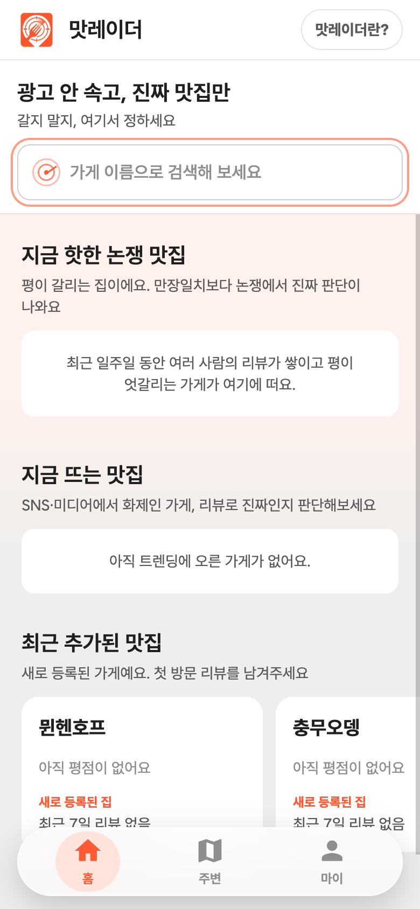
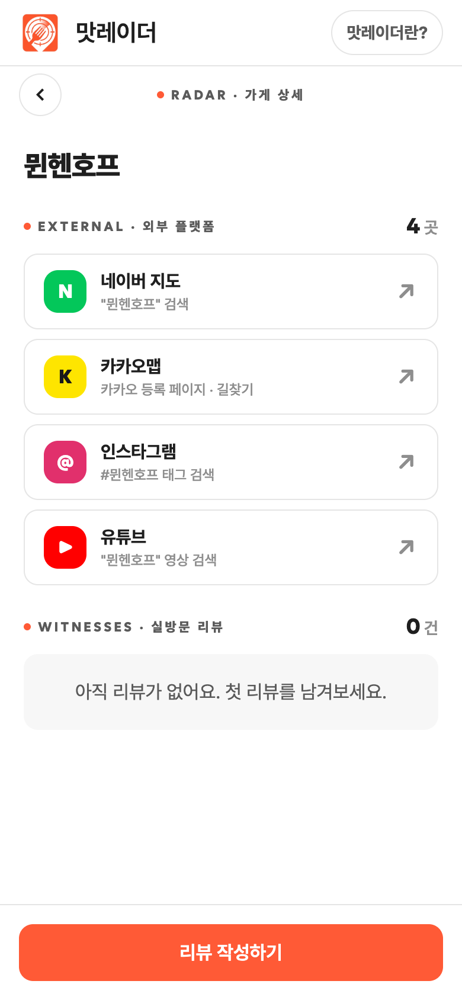
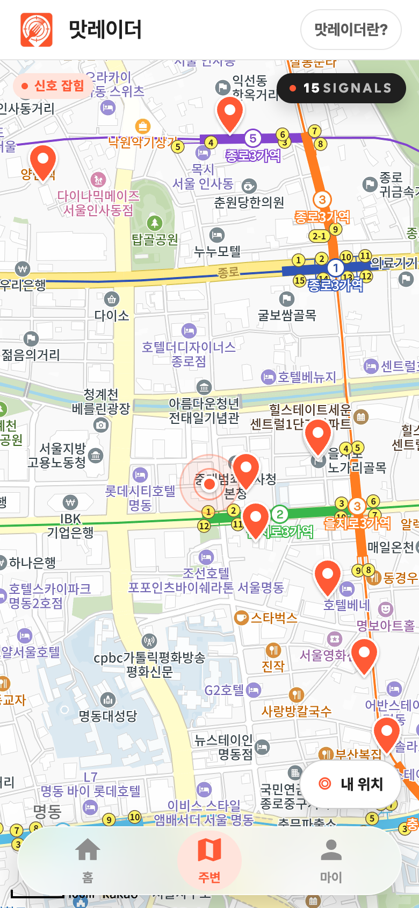

# 맛레이더 (MatRadar)

> 한국형 타베로그. **광고·체험단 리뷰에 속지 않고 진짜 맛집을 판단하게 돕는** 신뢰 기반 맛집 서비스.

운영 중 — **https://matradar.net** (모바일 웹)

| 첫 방문 소개 — 5점을 눌렀을 때 | 홈 | 가게 상세 | 주변 지도 |
|:---:|:---:|:---:|:---:|
|  |  |  |  |

<sub>운영 화면을 그대로 캡처했습니다. 출시 직후라 리뷰 데이터가 거의 없습니다. 주변 지도의 현재 위치는 캡처용 임의 좌표입니다.</sub>

---

## 이 레포에 대해

이 레포는 **열람용 발췌본**입니다.

- 서비스 코드는 비공개 레포에서 개발·운영합니다. 여기에는 구조를 보여 주는 **골격 코드 일부**와, 이 레포를 위해 새로 쓴 문서만 있습니다.
- 발췌한 파일은 원래 경로를 유지했지만, 의존하는 코드와 설정이 없어 **빌드·실행되지 않습니다.** `// …` 는 생략한 부분입니다.
- **리뷰 신뢰(어뷰징 탐지) 체계는 공개하지 않습니다.** 구조와 설계 개념만 [docs/review-integrity.md](./docs/review-integrity.md)에 있습니다.

---

## 무엇을 하는 서비스인가

> "여기저기 흩어진 맛집 정보를 한 곳에서 모아 보고, 광고·체험단에 속지 않고 판단까지 끝낼 수 있는 서비스"

| | |
|---|---|
| **맛집 DB 가 아니라 "논쟁 DB"** | 홈의 첫 섹션은 추천 목록이 아니라 **지금 평이 엇갈리는 가게**입니다 |
| **별점 인플레이션 방지** | 리뷰는 3점에서 시작하고, 4~5점을 고르면 바로 경고가 뜹니다 |
| **별점 색 자체가 메시지** | 1점 회색 → 3점 노랑 → 4점 골드 글로우 → 5점 무지개 반짝임 |
| **믿을 수 있는 평점** | 가게 평점은 작성자 신뢰도를 반영한 가중 평균이고, 한 사람은 가게당 최신 리뷰 1건만 반영됩니다 |
| **광고·체험단 제보** | 사용자가 제보하고 운영자가 확정한 가게에만 "광고 의심" 안내가 붙습니다 |

네이버·카카오와 경쟁하지 않고 **그 위에 올라탑니다** — 외부 링크로 이어 주고, 이 서비스는 판단에 집중합니다.

---

## 기술 스택

| 영역 | 선택 |
|---|---|
| 백엔드 | Java 25 · Spring Boot 4 · Spring Security(OAuth2 + JWT) · Spring Data JPA · QueryDSL · Flyway |
| 데이터 | MySQL 8.4 · Redis |
| 프론트엔드 | Expo(React Native) · TypeScript · Expo Router · react-query · zustand · axios · zod |
| 테스트 | JUnit · Testcontainers(실제 MySQL·Redis) · Jest · MSW |
| 인프라 | Cloudflare(DNS · 프록시 · Pages · R2) · VPS · Docker Compose · nginx · GitHub Actions |

테스트: 백엔드 약 800개, 프론트엔드 313개.

```
브라우저 ─▶ Cloudflare ─┬─▶ Pages (웹앱 정적 빌드)
                        └─▶ VPS: nginx ─▶ Spring Boot ─┬─▶ MySQL
                                                        └─▶ Redis
```

자세한 구성은 [docs/architecture.md](./docs/architecture.md), 배포·백업·감시는 [docs/operations.md](./docs/operations.md).

---

## 판단 사례

[docs/decisions.md](./docs/decisions.md)

1. **탐지는 판정이 아니라 우선순위로** — 오탐 비용이 비대칭이라 자동 제재를 두지 않고, 평점은 삭제 대신 가중으로 희석합니다.
2. **"성공" 메시지를 믿지 않고 결과를 확인하게** — 업로드 없이 성공한 백업, IPv6 /64 로 우회되던 IP 제한, 옛 버전이 돌던 "배포 완료".
3. **사진 처리 동시성을 건수가 아니라 메모리로** — 측정한 픽셀당 바이트로 예산을 잡은 공정 세마포어.

---

## 발췌 코드 지도

### 백엔드 — `backend/src/main/java/com/matradar/`

| 파일 | 보여 주는 것 |
|---|---|
| [`global/common/ApiResponse`](./backend/src/main/java/com/matradar/global/common/ApiResponse.java) | 모든 응답의 봉투 |
| [`global/exception/ErrorCode`](./backend/src/main/java/com/matradar/global/exception/ErrorCode.java) · [`GlobalExceptionHandler`](./backend/src/main/java/com/matradar/global/exception/GlobalExceptionHandler.java) | 에러 코드 단일 출처, 모든 예외를 봉투로 수렴 |
| [`global/auth/OAuthCodeStore`](./backend/src/main/java/com/matradar/global/auth/OAuthCodeStore.java) | 토큰을 URL 에 싣지 않는 일회용 code 교환 |
| [`global/auth/JwtAuthenticationFilter`](./backend/src/main/java/com/matradar/global/auth/JwtAuthenticationFilter.java) | 관리자 동시 세션 1개 — 밀려난 세션 축출 |
| [`global/auth/RateLimitClientKey`](./backend/src/main/java/com/matradar/global/auth/RateLimitClientKey.java) | IP 제한 키 — IPv6 를 /64 로 묶기 |
| [`global/common/RedisCounterScripts`](./backend/src/main/java/com/matradar/global/common/RedisCounterScripts.java) | 만료가 빠지지 않는 원자적 고정 창 카운터(Lua) |
| [`domain/photo/service/ImageProcessingLimiter`](./backend/src/main/java/com/matradar/domain/photo/service/ImageProcessingLimiter.java) · [`ImageMemoryEstimator`](./backend/src/main/java/com/matradar/domain/photo/service/ImageMemoryEstimator.java) | 예상 메모리 기반 동시 처리 제한 |
| [`domain/place/service/PlaceService`](./backend/src/main/java/com/matradar/domain/place/service/PlaceService.java) · [`entity/PlaceCreationIdempotency`](./backend/src/main/java/com/matradar/domain/place/entity/PlaceCreationIdempotency.java) | 가게 등록 멱등성 — 재응답 · 키 오용 · 동시 요청 |

### 프론트엔드 — `frontend/`

| 파일 | 보여 주는 것 |
|---|---|
| [`src/api/client.ts`](./frontend/src/api/client.ts) | 봉투 해제 · refresh 재시도 · 세션 축출 분기 순서 |
| [`src/types/dto/place.ts`](./frontend/src/types/dto/place.ts) · [`src/api/mappers/place.ts`](./frontend/src/api/mappers/place.ts) | DTO → 도메인 정규화(3층 분리) |
| [`src/components/review/StarRating.tsx`](./frontend/src/components/review/StarRating.tsx) · [`src/components/ui/tokens.ts`](./frontend/src/components/ui/tokens.ts) | 시그니처 별점 입력 — 색 규칙 · 키보드 · 스크린리더 |
| [`src/hooks/useUnsavedDraftGuard.ts`](./frontend/src/hooks/useUnsavedDraftGuard.ts) | 작성 중 이탈 보호 — 새로고침과 앱 내부 이동 둘 다 |
| [`src/lib/map/idle-search.ts`](./frontend/src/lib/map/idle-search.ts) | 지도 이동 재검색 규칙 — 이벤트 순서 대신 좌표로 판단 |
| [`scripts/build-web.js`](./frontend/scripts/build-web.js) | 운영 빌드 가드 — 산출물을 열어 검증 |

---

## 라이선스

라이선스를 부여하지 않습니다. **열람용**으로만 공개하며, 코드의 복제·수정·재배포를 허락하지 않습니다(All rights reserved).
